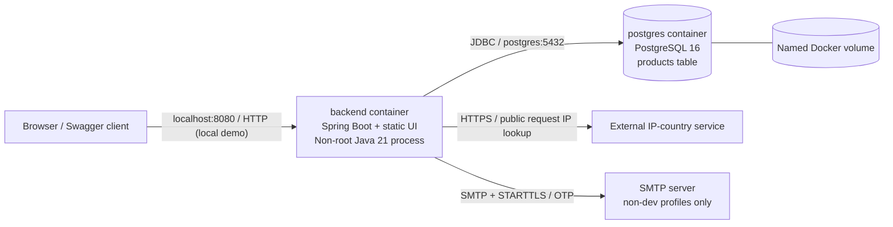
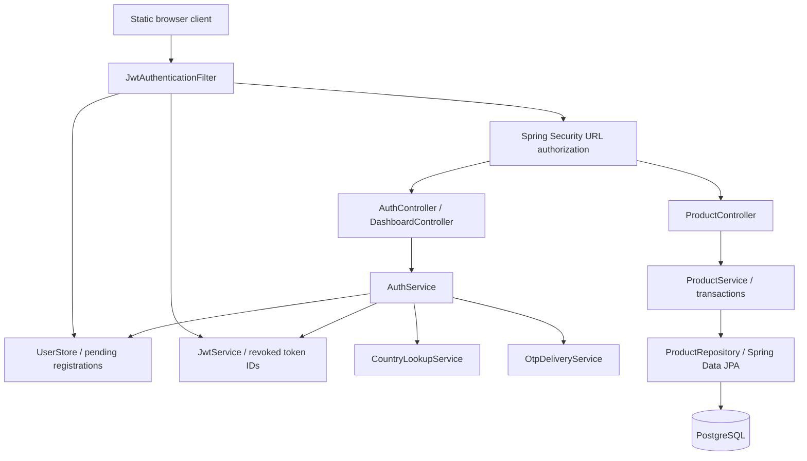
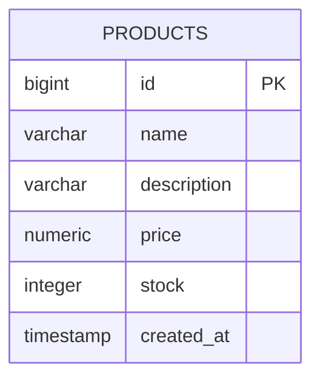
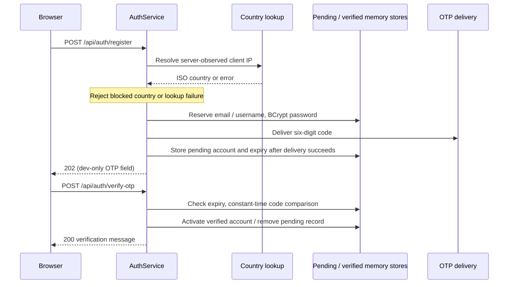
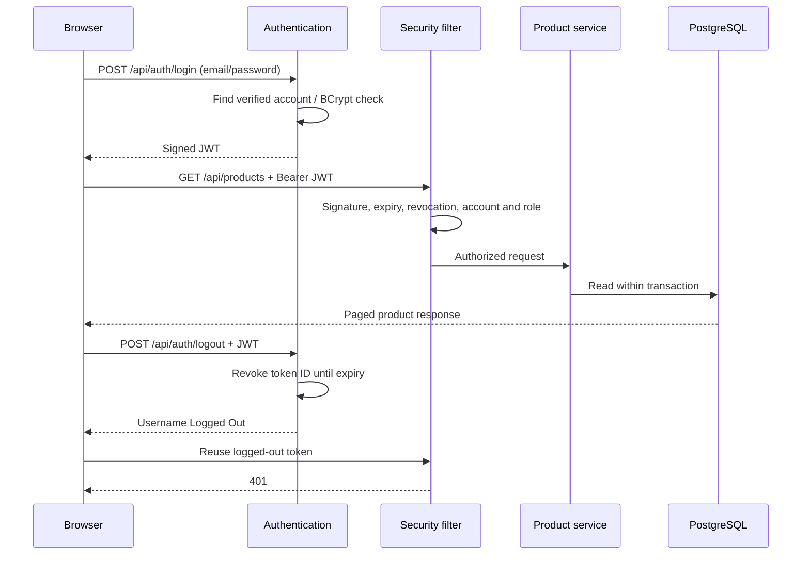

# Architecture: Northstar Account and Product Portal

## 1. Architectural decisions

This is a **modular monolith**, not a microservice system. One Spring Boot process serves both browser assets and the REST API. PostgreSQL is a separate Docker service.

| Decision | Why | Consequence |
|---|---|---|
| Java 21 / Spring Boot | The PDF explicitly requires Java/Spring Boot | Spring Security, MVC, validation, JPA, and OpenAPI share one runtime |
| Same-origin HTML/CSS/JavaScript | A separate frontend runtime is not needed for this UI | One app URL; no local Node.js build or CORS setup |
| In-memory accounts/OTPs/revocations | Required by the assignment's problem statement | Identity/session state disappears on backend restart; one replica only |
| PostgreSQL products | Explicit product persistence requirement | Products survive application and database container restarts through a named volume |
| JWT bearer sessions | Required authentication workflow | No HTTP server session; logout still needs a revocation store |
| Docker Compose | Repeatable developer/reviewer setup | Another machine needs Docker, not separate Java/Maven/PostgreSQL installations |
| Separate test database | Integration tests create/drop schema | Automated tests cannot destroy the application database |

The PDF also lists Express.js. Because the problem statement specifically requires Spring Boot, this implementation does not add a redundant Express backend. If use of Express is a separate mandatory acceptance criterion, confirm that before adding a second service.

## 2. System context and deployment topology

Default host bindings:

- App: `127.0.0.1:8080 -> backend:8080`.
- Optional direct database access: `127.0.0.1:55432 -> postgres:5432`.
- Database connections **inside** Docker always use `postgres:5432`. Container `localhost` means that container itself, not the database container.
- Compose project `northstar-task` isolates its network, services, and volume from other projects. Avoid running multiple copies under the same project name.

Compose waits for PostgreSQL's `pg_isready` check before starting the backend. The backend health check calls `/actuator/health`, which includes database health and returns no internal details. Health is observable readiness; Compose does not automatically repair a running service solely because it becomes unhealthy.

## 3. Application component boundaries

### HTTP and validation layer

Controllers accept validated request DTOs, not arbitrary entity objects. Registration enforces:

- Username: 8-50 characters.
- Email: valid email containing an underscore, following the unusual PDF rule.
- Password: 8-12 characters with uppercase, lowercase, a digit, and a special character.
- Role label: exactly `Standard User` or `Administrator`.

Product requests validate nonblank names, field lengths, decimal precision, positive prices, and nonnegative stock. Entity values are mapped into response DTOs. `ApiExceptionHandler` handles defined API/validation errors. Spring Security writes JSON 401/403 errors before controllers run.

Expected statuses include 400 for invalid input, 401 for missing/invalid authentication, 403 for denied role/country, 404 for missing products, 409 for conflicting registration, and 503 for country lookup or SMTP delivery failures. Unanticipated framework/database errors are not all normalized to the custom message shape; do not assume every possible failure has the same body.

### Auth and user layer

`UserStore` indexes verified accounts by normalized email. `AuthService` owns pending registrations. Registration and OTP verification synchronize on the service to keep username/email reservation and activation consistent inside one process.

Password hashing and OTP delivery currently occur inside that synchronization boundary. This is intentionally simple but limits registration throughput: a slow SMTP call can delay other registration/verification requests. Network timeouts bound that delay; a higher-throughput design would separate identity reservation, asynchronous delivery, and activation.

### Product layer

`ProductController` delegates to `ProductService`, which owns transaction boundaries. The JPA repository provides parameter-bound persistence queries. All authenticated roles may manage the **shared** catalog; there is no product owner, tenant, or administrator-only product restriction.

Pagination is zero-based, defaults to 10 rows, and is capped at 100. Sorting uses Spring Data's pageable sort parameters. Responses use the stable `content` and `page` structure. No search/filter feature or optimistic locking is implemented.

## 4. Data ownership, model, and lifecycle

| State | Owner | Storage | Lifetime / restart behavior |
|---|---|---|---|
| Username, email, password hash, role | `UserStore` | Concurrent in-memory map | Lost when backend exits |
| Pending account, OTP, expiration, failed-attempt count | `AuthService` | In-memory map | Five-minute default expiry; removed after verification, five wrong codes, or expiry cleanup |
| JWT | Browser/client | `sessionStorage` in this UI | Default 15-minute expiry; browser session scope, independent of server memory |
| Revoked JWT IDs and expirations | `JwtService` | In-memory map | Lost on backend restart; expired entries cleaned during later logout activity |
| Products | Product module | PostgreSQL table | Retained in Docker volume |
| Bootstrap admin | `AdminBootstrap` | Recreated in memory from non-dev configuration | Recreated on every non-dev startup |

### Product model

- ID: database-generated identity.
- Name: maximum 120 characters, non-null.
- Description: maximum 1000 characters.
- Price: `NUMERIC(12,2)`; requests allow up to 10 integer digits and two fractional digits, minimum 0.01.
- Stock: non-null integer, request value zero or greater.
- Creation time: set before insert and not overwritten by updates.
- No account foreign keys exist because accounts are not in the database.

Hibernate currently uses `ddl-auto=update` for the local app and `create-drop` only for isolated tests. That is not a production migration strategy. Use versioned Flyway/Liquibase migrations and schema validation for a durable deployment.

### Restart and scaling implications

Restarting PostgreSQL preserves products because data is in the named volume. Restarting the backend removes ordinary user accounts, requiring re-registration. Copying source to another machine does not copy the volume; use a database dump/restore to move products.

The JWT design is not fully stateless: account and revocation checks depend on this process's memory. Running two backend replicas would create inconsistent accounts, OTPs, and logout state. A token's permanent revocation must not be assumed after restart, especially if the same identity is recreated with the same signing key. Production needs durable session/revocation state or a restart-safe token/session version strategy.

## 5. Request sequences

### Registration and OTP

The user cannot log in before verification. Wrong codes increment the pending challenge's attempt counter; five failures invalidate it. Expired registration reservations are removed during a later signup. There is no separate resend endpoint; a new registration is possible after expiry/invalidation.

### Login, product access, logout

JWT claims include `sub` (email), `jti`, `iat`, `exp`, username, and role. HMAC signing uses the configured secret. This implementation does not issue refresh tokens. Login failure returns `Login Failed`; `/api/auth/error` also exposes that required response. These are JSON APIs, not server-side page redirects.

## 6. Location and deployment trust boundary

Country is derived from `HttpServletRequest.getRemoteAddr()`, not from a browser-supplied country. Public IP lookup uses the configured provider, with a three-second connection timeout and five-second read timeout. Provider failure/invalid response blocks signup.

Private/loopback addresses have no useful public country. The Docker dev setup maps these to `LOCAL_COUNTRY=US`, so local signup tests **do not prove real-world geolocation accuracy**. Outside dev, the fallback defaults to empty and private-address signup fails closed.

A reverse proxy or Docker NAT may obscure the original public client address. Production must establish which proxies are trusted and how the true client IP is passed; blindly trusting arbitrary `X-Forwarded-For` enables country-policy bypass. This demo does not implement that deployment-specific proxy integration.

Public-IP lookup sends the client IP to the configured external provider. Review privacy, availability, and provider limits before real deployment.

## 7. Build, environments, and operational model

The multi-stage Dockerfile has:

1. `source`: Maven/JDK and dependencies, cached separately from source changes.
2. `test`: runs the suite against a database selected through `TEST_DATABASE_*`.
3. `build`: compiles, runs the default H2 suite, and packages an executable JAR.
4. `runtime`: Java JRE and packaged JAR only, running as non-root `app`.

The default Docker runtime profile is explicitly `dev`. The optional `test` Compose profile starts a dedicated tmpfs PostgreSQL service and a Maven test container. It has no application-data volume and no database host port.

The build is portable across Docker-capable machines; local Java/Node versions do not affect it. Image tags can receive upstream updates, so pin approved image digests for release reproducibility. Maven dependency versions are governed by the checked-in POM and Spring Boot dependency management.

See [RUNNING.md](RUNNING.md) for exact commands, database transfer, port conflicts, and another-machine setup. See [TESTING.md](TESTING.md) for actual verification and boundaries.

## 8. Production gaps and evolution path

This is a machine-test/demo application, not a claim of production readiness:

1. **Durable identity:** persist users and unique indexes in PostgreSQL; persist pending challenges/revocations in a suitable shared TTL store.
2. **Session integrity:** durable logout semantics, signing-key rotation, explicit token audience/issuer policy, and a considered refresh/re-authentication design.
3. **Concurrency:** remove network I/O from the registration lock and add product optimistic locking if concurrent edits matter.
4. **API hardening:** rate limits, uniform unexpected-error handling, reviewed sort allowlists, and integration tests for deployment proxy behavior.
5. **Account policy:** keep the PDF's 8-12 password rule only for assignment acceptance; adopt an appropriate production password policy and administrator provisioning process.
6. **Delivery:** real SMTP/OTP-delivery monitoring and retry policy; no OTPs in public responses or logs.
7. **Operations:** TLS, secrets management, migrations, backup/restore drills, resource sizing, monitoring, and an external readiness/repair strategy.

Keep the modular monolith until scale or team boundaries actually require service separation. Externalizing shared state is a prerequisite for horizontal scaling, not splitting controllers into services.
